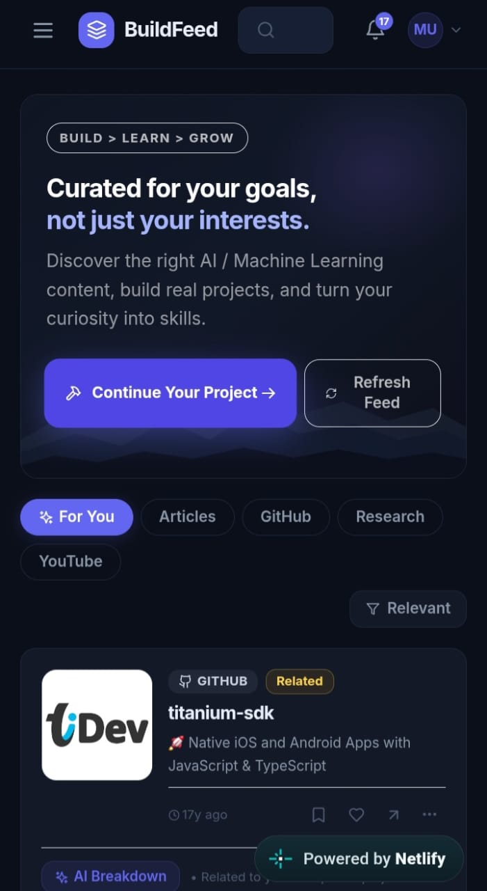
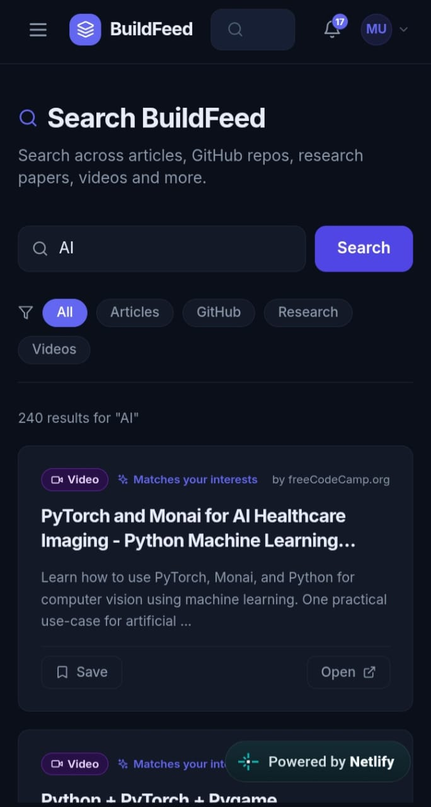
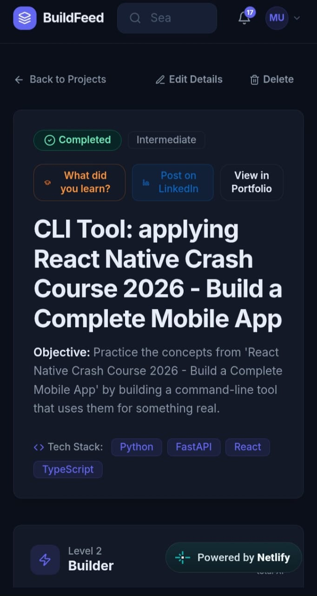
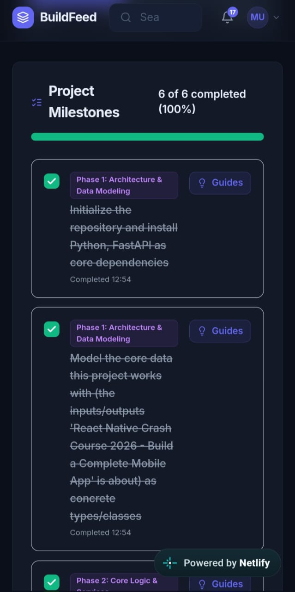
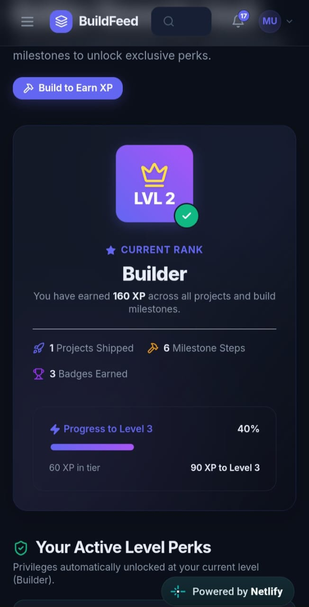
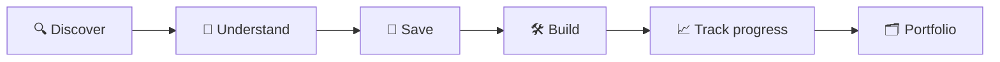
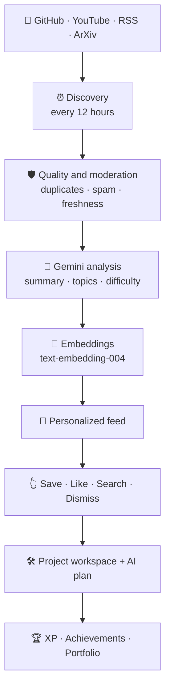
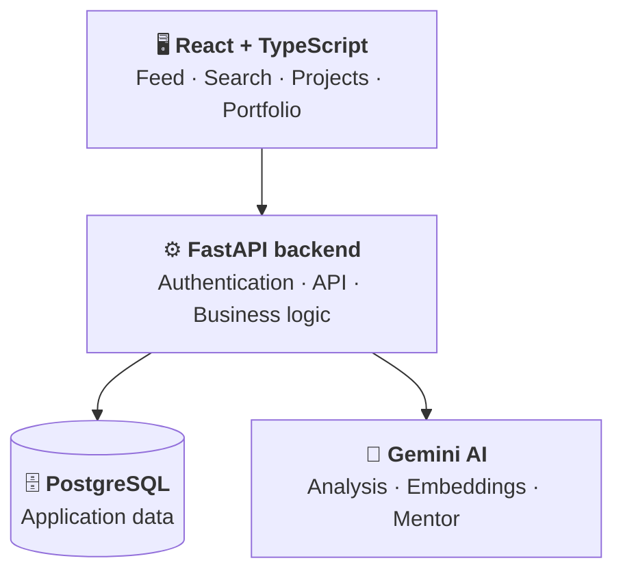

# 🛠️ BuildFeed

**Stop scrolling. Start building. A personalized technical content feed that turns browsing sessions into real projects.**


---

## ✨ What is this?

BuildFeed finds articles, GitHub repos, YouTube tutorials, and research papers, analyzes them with AI, ranks them by your interests and skill level, and then helps you **build something with them**.

Developers constantly find great technical content, save it, and never come back:

🔍 Discover → 🔖 Bookmark → 📜 Scroll more → 😶 Forget → 🔁 Repeat

BuildFeed breaks that loop:

| Problem | How BuildFeed helps |
|---|---|
| 🌊 **Information overload** | AI-ranked feed filtered to your topics and level |
| 😴 **Passive consumption** | A daily scroll limit nudges you to start building |
| 🧱 **No path from idea to project** | Saved content becomes a project with an AI build plan |

---

## 📸 Screenshots

<table>
  <tr>
    <td align="center" width="20%"></td>
    <td align="center" width="20%"></td>
    <td align="center" width="20%"></td>
    <td align="center" width="20%"></td>
    <td align="center" width="20%"></td>
  </tr>
  <tr>
    <td align="center"><b>🎯 For You feed</b></td>
    <td align="center"><b>🔎 Search</b></td>
    <td align="center"><b>🛠️ Project</b></td>
    <td align="center"><b>✅ Milestones</b></td>
    <td align="center"><b>🏅 Progression</b></td>
  </tr>
</table>

---

## 🔁 The core loop



1. 📡 A background pipeline fetches fresh content from GitHub, YouTube, and RSS every 12 hours.
2. 🤖 Gemini categorizes, summarizes, difficulty-rates, and embeds each item.
3. 🎯 Your feed ranks content by interests, experience, behavior, and semantic similarity.
4. ⏱️ A daily limit (default 10 items) interrupts scrolling and suggests a project.
5. 📋 Saved items become project workspaces with step-by-step plans.
6. 🏆 Finished projects earn XP and appear on a public portfolio.

---

## 🎯 Key features

| | Feature | What it does |
|---|---|---|
| 🎯 | **Personalized feed** | Scores every item against interests, level, history, and semantics, with a strict topic-relevance gate |
| 🤖 | **AI content analysis** | Summary, topics, technologies, difficulty, category, project potential, and a 0-100 relevance score |
| 🔎 | **Hybrid search** | SQL text matching plus cosine similarity over Gemini embeddings |
| ⏱️ | **Focus gate** | Daily scroll limit with a contextual "Now Build" suggestion |
| 🔗 | **URL import** | Paste any public URL and get analysis plus a build plan (Instagram and TikTok via oEmbed) |
| 🗂️ | **Project workspaces** | AI-generated objectives, tech recommendations, and build steps |
| 🧑‍🏫 | **AI mentor** | Per-project chat that answers technical questions in context |
| 📘 | **Step guides** | Key concepts, tips, pitfalls, and library suggestions for each step |
| 🧪 | **Learning quiz** | 8 technical questions generated when a project is completed |
| ❤️ | **Likes and trending** | Rolling 7-day trending feed |
| 🏅 | **XP and achievements** | 10 XP per step, 100 XP per project, levels and badges |
| 🌐 | **Public portfolio** | Shareable `/p/:slug` page and LinkedIn post generation |
| 🛡️ | **Quality layer** | Rejects near-duplicates, broken URLs, spam, unsafe, and stale content |
| 🔁 | **Feedback loop** | Mark content "Too Basic", "Too Advanced", or "Not Relevant" |

---

## 🧠 AI pipeline

All AI runs on **Google Gemini** (no OpenAI dependency).



### ⚖️ Feed scoring

| Signal | Weight |
|---|---|
| 🏷️ Topic relevance | 40% |
| 🎓 Expertise match | 25% |
| 🧬 Semantic similarity | 15% |
| 👤 Behavioral signals | 10% |
| ⭐ Quality, freshness, goals | 10% |

Items below a minimum topic and expertise threshold are removed before composite scoring.

> ⚠️ **What these numbers are:** the weights are **design choices** for how BuildFeed prioritizes relevance, not measured outcomes or the result of an experiment.

#### 🧮 Worked example (illustrative values)

The values below are **made up for illustration**. Each signal is scaled 0 to 1, multiplied by its weight, and summed to a score out of 100.

| Signal (weight) | 📘 Item A: FastAPI auth tutorial | 🧬 Item B: general ML paper | 🧪 Item C: loosely related video |
|---|---|---|---|
| Topic relevance (40) | 0.9 → **36.0** | 0.6 → **24.0** | 0.3 → **12.0** |
| Expertise match (25) | 1.0 → **25.0** | 0.4 → **10.0** | 0.4 → **10.0** |
| Gate: topic + expertise ≥ 25? | 61.0 ✅ pass | 34.0 ✅ pass | 22.0 ❌ removed |
| Semantic similarity (15) | 0.7 → **10.5** | 0.9 → **13.5** | 0.9 → *(not scored)* |
| Behavioral signals (10) | 0.4 → **4.0** | 0.8 → **8.0** | *(not scored)* |
| Quality / freshness / goals (10) | 0.8 → **8.0** | 0.9 → **9.0** | *(not scored)* |
| **Total** | **83.5** | **64.5** | **excluded** |

**Why A ranks above B:** A matches the user's interests and level much better, and those two signals carry 65% of the weight. B scores higher on semantic similarity and behavior, but not enough to make up the gap.

**Why C never shows up:** despite strong semantic similarity, it fails the topic and expertise gate, so it is removed before composite scoring. This is how the feed stays on-topic.

### 📡 Content sources

| Source | What is discovered |
|---|---|
| 🐙 **GitHub** | Public repos via the Search API (stars, forks, topics, README snippet) |
| ▶️ **YouTube** | Tutorials via YouTube Data API v3 (skipped if no key) |
| 📰 **RSS / Atom** | Any feed, e.g. Hacker News and ArXiv (ArXiv is tagged as research papers) |
| 🔗 **External URL** | Manually submitted pages with metadata extraction, AI analysis, and `robots.txt` respected |

---

## 🧰 Tech stack

| Layer | Tools |
|---|---|
| ⚙️ **Backend** | Python 3.11+, FastAPI, SQLAlchemy 2.0, Alembic, Pydantic v2, httpx |
| 🗄️ **Database** | PostgreSQL (Neon), psycopg2 |
| 🔐 **Auth** | JWT (python-jose), bcrypt (passlib) |
| 🤖 **AI** | Gemini API (analysis, embeddings, mentor chat) |
| 🖥️ **Frontend** | React 18, TypeScript, Vite, React Router v6, TanStack Query v5, Tailwind CSS v3, Axios |
| ☁️ **Hosting** | Railway (backend), Netlify (frontend) |
| 🧪 **Testing** | pytest |

### 🏗️ Architecture

The big picture:



> This is a conceptual diagram based on the documented stack, not a verified map of every runtime connection.

<details>
<summary>📁 Repository layout</summary>

```text
BuildFeed/
├── backend/
│   ├── app/
│   │   ├── api/v1/      # FastAPI route modules (thin controllers)
│   │   ├── core/        # Config, DB session, security, email
│   │   ├── models/      # SQLAlchemy ORM models
│   │   ├── schemas/     # Pydantic request/response schemas
│   │   └── services/    # Business logic (ai, discovery, embedding, feed,
│   │                    #  focus, mentor, project, quality, search, ...)
│   ├── alembic/         # Database migrations
│   ├── tests/           # pytest suite
│   └── requirements.txt
└── frontend/
    └── src/
        ├── app/         # Router and providers
        ├── components/  # Reusable UI
        ├── features/    # Auth and theme context
        ├── pages/       # One file per route
        ├── services/api/# One Axios module per API domain
        └── types/       # Shared TypeScript interfaces
```

</details>

---

## 🚀 Quick start

**Prerequisites:** Python 3.11+, Node.js 18+, PostgreSQL, and a [Gemini API key](https://ai.google.dev). YouTube and GitHub keys are optional.

**1. 📦 Clone**

```bash
git clone https://github.com/munibashami07-oss/BuildFeed.git
cd BuildFeed
```

**2. 🐍 Set up the backend**

```bash
cd backend
python -m venv .venv
```

```bash
# macOS / Linux
source .venv/bin/activate
```

```powershell
# Windows
.venv\Scripts\activate
```

```bash
pip install -r requirements.txt
```

**3. 🔐 Create `backend/.env`** (see [Configuration](#️-configuration)), then run migrations:

```bash
alembic upgrade head
```

**4. ▶️ Start the API**

```bash
uvicorn app.main:app --reload --host 0.0.0.0 --port 8000
```

API: `http://localhost:8000` · Docs: `http://localhost:8000/docs`

**5. 🖥️ Start the frontend** (new terminal)

```bash
cd frontend
npm install
echo "VITE_API_URL=http://localhost:8000/api/v1" > .env
npm run dev
```

App: `http://localhost:5173`

---

## ⚙️ Configuration

### Backend `backend/.env`

🔒 Never commit this file.

| Variable | Required | Description |
|---|---|---|
| `DATABASE_URL` | ✅ | PostgreSQL connection string |
| `JWT_SECRET` | ✅ | Long random string for signing JWTs |
| `GEMINI_API_KEY` | ✅ | Enables AI analysis, embeddings, and semantic search |
| `GEMINI_MODEL` | | Default `gemini-2.5-flash` |
| `GEMINI_EMBEDDING_MODEL` | | Default `text-embedding-004` |
| `YOUTUBE_API_KEY` | | YouTube discovery is skipped without it |
| `GITHUB_TOKEN` | | Raises the Search API rate limit |
| `GITHUB_CLIENT_ID` / `GITHUB_CLIENT_SECRET` | | GitHub OAuth for "Build This" repo creation |
| `GITHUB_TOKEN_ENCRYPTION_KEY` | | Fernet key for encrypting stored GitHub tokens |
| `SMTP_HOST` / `SMTP_USERNAME` / `SMTP_PASSWORD` / `SMTP_FROM_EMAIL` | | Password-reset emails |
| `FRONTEND_URL` | | Frontend origin for redirects |
| `CORS_ORIGINS` | | JSON array of allowed origins |
| `CONTENT_DISCOVERY_INTERVAL_HOURS` | | Default `12.0` |
| `FEED_CONTENT_LIMIT` | | Daily scroll limit, default `10` |

### Frontend `frontend/.env`

| Variable | Required | Description |
|---|---|---|
| `VITE_API_URL` | ✅ | Backend base URL including `/api/v1` |

---

## 🔌 Usage: API overview

All endpoints live under `/api/v1`. Full interactive docs are at `/docs`.

| Group | Prefix | Purpose |
|---|---|---|
| 🔐 Auth | `/auth` | Register, login, GitHub OAuth, password reset, onboarding |
| 🎯 Feed | `/feed` | Personalized "For You" feed |
| 📡 Discovery | `/discovery` | Run discovery cycles, manage sources |
| 🔎 Search | `/search` | Hybrid text and semantic search |
| 🔖 Saved | `/saved` | Bookmarks and external URL import |
| ⏱️ Focus | `/focus` | Scroll limit status and project suggestions |
| 🛠️ Projects | `/projects` | Workspaces and build steps (mentor at `/projects/{id}/mentor`) |
| 🏅 Progress | `/progression`, `/achievements` | XP, levels, badges |
| 🌐 Portfolio | `/portfolio`, `/public` | Portfolio and sharing |
| ❤️ Likes | `/likes` | Likes and 7-day trending |
| 🔔 Other | `/notifications`, `/dashboard`, `/settings`, `/quality` | Notifications, stats, preferences, quality checks |

---

## 🧪 Testing and limitations

```bash
cd backend
pytest -v                       # run all backend tests
pytest tests/<test_file>.py -v  # run a single test file
```

Backend tests live in `backend/tests/` and are written with `pytest`. Run the suite locally and check the results yourself before relying on any behavior described in this README.

**Known limitations**
- 🚫 The frontend has no automated tests.
- 📉 Backend coverage percentage is not tracked in CI.
- 📄 There is no `.env.example` yet, so `.env` must be created by hand.
- 📊 Feed-scoring weights are design choices and have not been validated against user outcomes.
- 🔌 AI features depend on external APIs (Gemini, and optionally YouTube and GitHub), so they are subject to those services' limits and availability.

---

## 🛡️ Security

These are the project's security practices and design goals. This is a personal project and has not had an independent security audit, so review the code before deploying it anywhere that matters.

- 🔑 Secrets belong in `.env` files, which are listed in `.gitignore`
- 🔐 Stored GitHub tokens are intended to be encrypted with Fernet (`GITHUB_TOKEN_ENCRYPTION_KEY`)
- 🎫 Authentication uses JWTs with a configurable expiry
- 🧂 Passwords are hashed with bcrypt via passlib
- 🌐 URL import is designed to reject private and localhost addresses (SSRF) and to respect `robots.txt`
- 🚦 Login and password-reset endpoints are designed to be rate limited
- 🧱 Database access goes through SQLAlchemy ORM queries

For sensitive security issues, please don't post publicly.

---

## 🗺️ Roadmap

> Proposed next steps, based on the current limitations. Not commitments.

| Status | Item |
|---|---|
| ✅ Built | Personalized feed, AI analysis, hybrid search, focus gate, project workspaces, XP, portfolio |
| 🔜 Next | Add `.env.example` and a one-command local setup |
| 🔜 Next | Add frontend tests and track backend coverage in CI |
| 🔜 Next | Add a short demo GIF, plus desktop and focus-gate screenshots |
| 💭 Later | Validate feed-scoring weights against real user feedback ("Too Basic" / "Too Advanced" signals) |
| 💭 Later | Add more content sources and per-source tuning |
| 💭 Later | Improve observability for the discovery pipeline |

---

## 🤝 Contributing

Contributions are welcome.

1. 🔎 Check [open issues](https://github.com/munibashami07-oss/BuildFeed/issues) and [pull requests](https://github.com/munibashami07-oss/BuildFeed/pulls). For big changes, open an issue first.
2. 🍴 Fork the repo and clone your fork.
3. 🌿 Create a branch from `main`:
   ```bash
   git checkout -b feature/short-description
   ```
4. 🛠️ Keep changes focused. Route handlers stay thin, and business logic goes in `services/`.
5. ✅ Add or update `pytest` tests for backend changes.
6. 🧪 Run `pytest` before pushing.
7. 💬 Commit with a clear message, e.g. `feat: add feed dismiss endpoint` or `fix: handle empty RSS entries`.
8. 📤 Open a pull request against `main` describing the problem, the fix, and how you tested it. Add screenshots for UI changes.

🔒 Never commit `.env` files, API keys, or tokens.

---

## ⭐ Support

If BuildFeed helps you build more and scroll less, give the repo a **star** ⭐.

**From scrolling to building.**

Made with ❤️ by **[Muniba](https://github.com/munibashami07-oss)**
